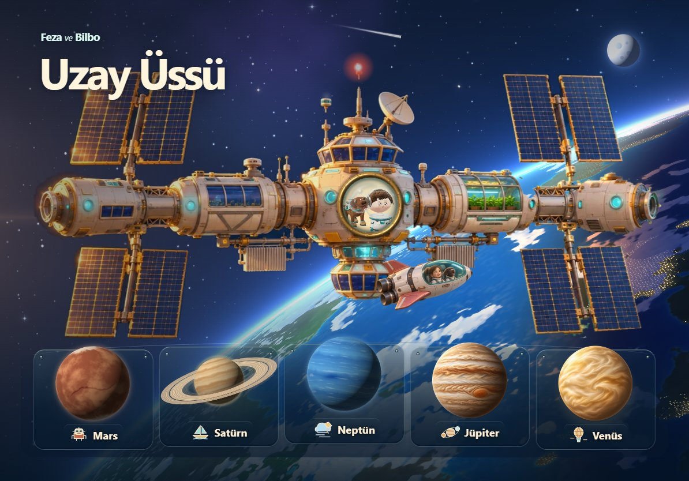
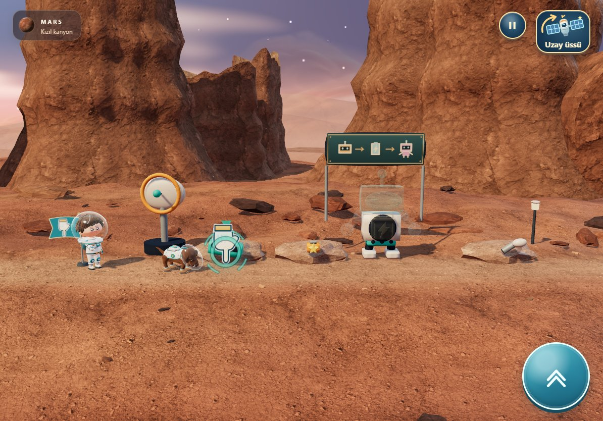
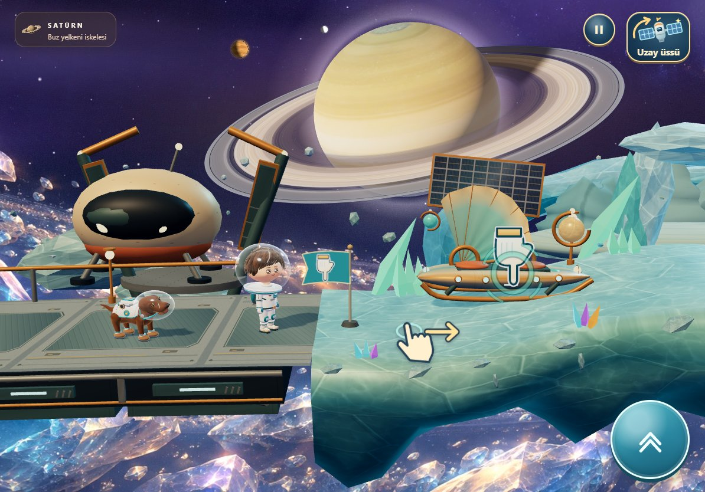
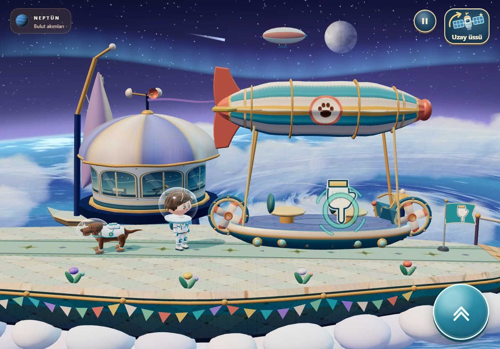
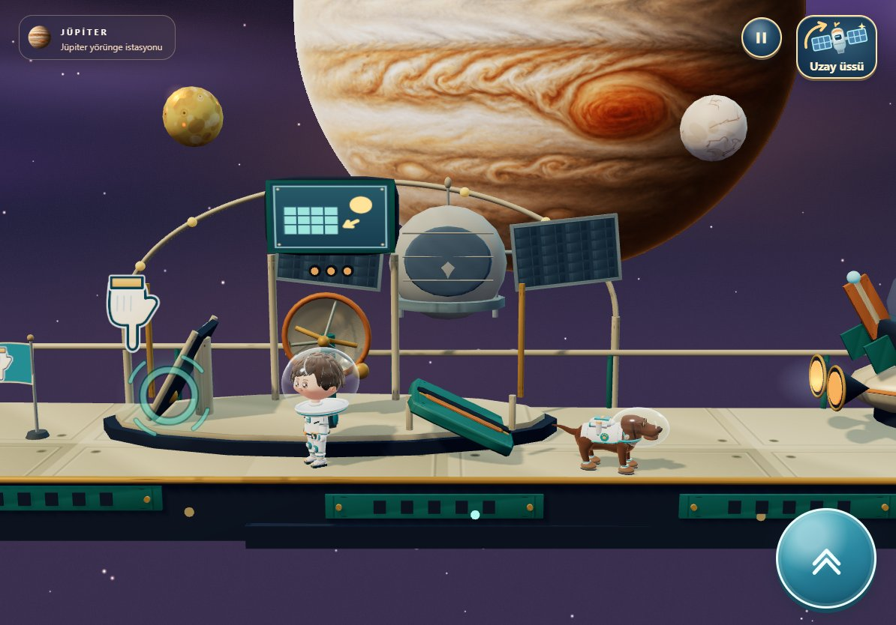
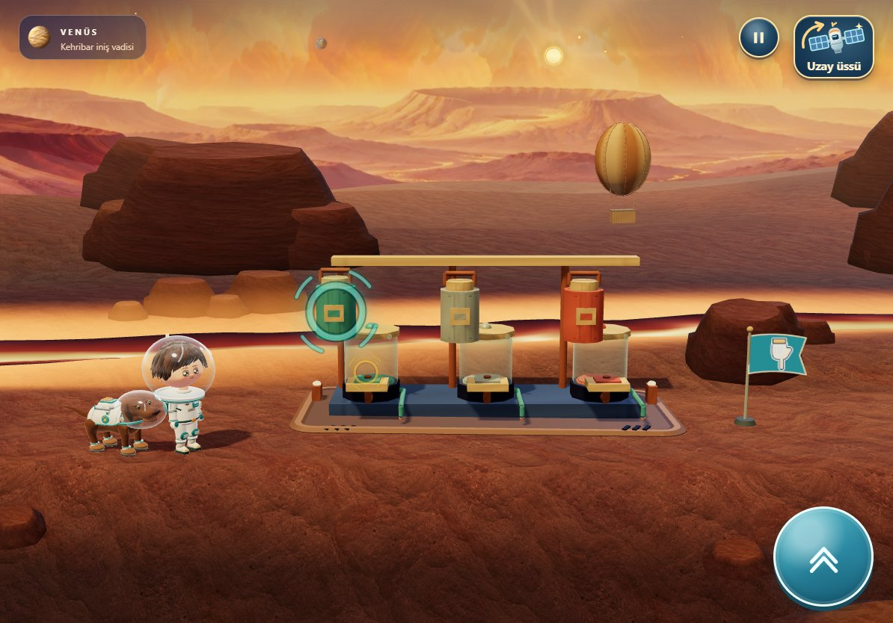

# Feza ve Bilbo’nun Uzay Macerası 🚀🐾

Astronot Feza ve çikolata Labrador'u Bilbo, Dünya yörüngesindeki üsten beş gezegene uçar.
Dört–beş yaş için yapılmış, üç boyutlu bir keşif oyunudur. Yazı okumak gerekmez.
Gerçek nesnelere dokunarak, onları sürükleyip çevirerek oynanır. Süre baskısı ve ceza yoktur.

**Oyna:** https://goktugkarpat.github.io/feza-bilbo-uzay-macerasi/

## Gezegenler

Uzay üssünde arkada Dünya döner; istasyonun penceresinden Feza ile Bilbo el sallar. Gezegen resmine dokununca roket uçar.

| | |
|---|---|
|  |  |
| **Mars.** Robotu topla, aracı kur, köprüyü tamamla. Serada tohum ek, buz mağarasında kızakla kay; sonunda bilim kampını canlandır. | **Satürn.** Buz yelkenlileriyle halkalarda yol al. Buz çanlarını çal, örnek topla, küçük ayı Güneş'in önüne kaydırıp tutulma yap; kristal bahçesini büyüt. |
|  |  |
| **Neptün.** Bulut gemisiyle üst ya da alt hava akımını seç. Çarkları çevir, uçurtmayı uçur, kumaş ör; keşif balonunu göğe taşı. | **Jüpiter.** Yörünge istasyonundan Io ve Europa'ya git. Robot koluyla taş topla, küçük su altı aracını buzlara yönlendir; keşif müzesini aç. |

**Venüs.** Cam kubbeli araçla dört bilim durağına uğra. Buharı yönlendir, köprü parçalarını taşı, örnek topla.
Gözlem balonlarını hazırla; topladıkların son gözlemevini canlandırır.

## Nasıl açılır

- **İnternette:** https://goktugkarpat.github.io/feza-bilbo-uzay-macerasi/
- **iPad'de uygulama gibi:** Safari'de adresi aç → **Paylaş** → **Ana Ekrana Ekle**.
  İlk açılıştan sonra internetsiz de oynanır.
- **Bilgisayarda:** `index.html` dosyasını tarayıcıyla aç.
  Mac'te Python 3 varsa `oyunu-ac.command` yerel sunucuyu açar; oynarken penceresi açık kalsın.
- **Sessiz açma:** adresin sonuna `?sessiz` ekle.

## Nasıl oynanır

- Ekranın sol ya da sağ yanına basılı tut: Feza yürür. Büyük okla zıplar.
- Turkuaz halka dokunulacak nesneyi, altın halka götürüleceği yeri gösterir.
- Küçük el dokunmayı, sürüklemeyi ve çevirmeyi örnekler. Takılınca oyun yardım eder.
- Nesneyi yanlış yere bırakmanın cezası yok; yeniden tutup devam edilir.
- Büyük ok görevleri kendisi çözmez; işi çocuk yapar ve sonucu sahnede kalır.
- Sağ üstteki **Uzay üssü** düğmesi üsse döndürür; ‖ düğmesi mola verir.
- Klavye (yedek): A/D veya oklar yürür, Boşluk zıplar, E kullanır, Esc mola.

## Ebeveyn için notlar

- **Kayıt yok:** her gezegen ziyareti baştan başlar. Mola, aynı ziyaretteki keşifleri korur.
- Tamamlanan yolculuğun küçük fotoğrafı, istasyon açık kaldıkça gezegenin yanında görünür.
- Moladan ses ve yazılı ipuçları açılıp kapatılabilir. Yalnız ses tercihi hatırlanır.
- iPad'de hedef 60 FPS'dir. Ölçüm göstergesi için adrese `?fps` ekle.
- **GitHub'a göndermek:** klasördeki `yayinla.command` dosyasına çift tıkla.

## Gizlilik ve kaynaklar

- Aile fotoğrafları oyundaki 3B Feza ve Bilbo modellerinden yapılır; kamera ya da gerçek fotoğraf kullanılmaz.
- Gezegenler bilimden esinlenen hayalî, güvenli keşif alanlarıdır. Satürn gezisi halkalarda, Neptün gezisi bulut istasyonlarında geçer.
  Oyun, Jüpiter'in katı yüzeyi olduğunu ya da Europa'da yaşam bulunduğunu iddia etmez.
- Mars kaplamalarının kaynakları `assets/textures` içinde, Satürn görsellerininki `assets/orbit/saturn-credits.txt` dosyasındadır.
- Türkçe anlatıcı kayıtları Microsoft Emel sesiyle üretildi.
- Üs ve uçuş çizimleri oyun için hazırlandı. Görsel başvuru: NASA'nın [Mars](https://science.nasa.gov/mars/facts/),
  [Satürn](https://science.nasa.gov/saturn/facts/) ve [Neptün](https://science.nasa.gov/neptune/neptune-facts/) sayfaları.
- Jüpiter ve Venüs'ün üs resimleri ile Venüs'ün volkanik panoraması ve bazalt yüzeyleri ImageGen ile üretildi
  (Venüs görsel paketi: `assets/venus/scene-art.js`). Oyun uzak bir görsel servisine ihtiyaç duymaz.

## Yapım

Bu oyun, Feza'nın babası **Göktuğ Karpat** (@goktugkarpat) ile yapay zekâ yardımcıları **Claude Code** (Anthropic), **Codex** (OpenAI) ve **Antigravity** (Google) birlikte çalışarak yapılmıştır.
Fikirler, gezegenler ve kararlar ailenindir; kod, 3B sahneler, bilim düzenekleri ve düzenlemeler bu yardımcılarla birlikte yazılmıştır.
Oyun yalnızca Feza için, kâr amacı olmadan yapılmış bir aile projesidir.
